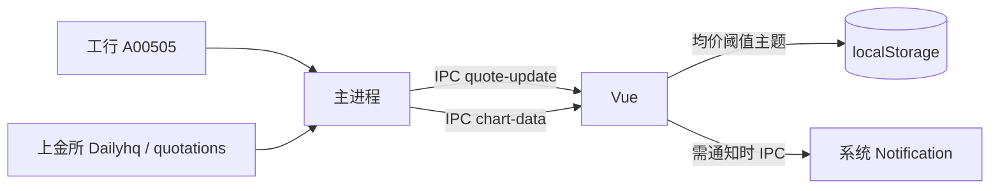

# 工行如意金监测与账本提醒

日期：2026-11-18  
路径：`/Users/github/golden-monitoring`  
状态：设计已确认（含视觉 / 走势图增补），待实现

## 最高规范

**人类可读性第一，禁止过度设计。** 仅 Electron 桌面应用；行情与走势只经主进程；账本与设置只在渲染进程 `localStorage`。组件样式只引用 SCSS 主题变量，禁止写死色值。

## 背景与目标

个人监看工商银行「如意金积存」买卖价，维护本地攒金账本，并按加权均价对赎回价做接近回本 / 越涨系统通知。首屏用上金所 Au99.99 走势图做美观主视觉。参考 `arrange-cue` 的 electron-vite + electron-builder 套壳，支持 macOS / Windows 打包。

## 非目标

- 不做纯静态网页 / Nginx 部署模式
- 不接积存金 `A00622`、飞书等第三方推送
- 不做工行如意金官方历史 K（该产品无公开历史接口）
- 首版不做自动更新与 Mac 公证

## 产品范围

| 项 | 约定 |
|----|------|
| 实时买卖 | 工行如意金积存（`tranCode=A00505`） |
| 走势图 | 上金所 Au99.99 日线（1M/3M/1Y）+ 可选今日分时 |
| 运行形态 | 仅 Electron 应用 |
| 视觉 | C1 粉紫梦核；布局 L2 左右分栏；SCSS 主题可切换 |
| 提醒 | 系统通知 + 应用内最近一条文案；总开关可关 |
| 账本 | 多笔攒金，可增改删，加权汇总 |

## 视觉与布局

- **风格**：C1 粉紫梦核——粉紫青渐变背景、大圆角、轻星点装饰；年轻向，避免商务金融风
- **称谓**：主标题可用「攒金小本本」，副标「黄金监测 / 如意金」
- **布局 L2**：宽屏左侧为走势图 + 区间切换；右侧为账本录入与列表；顶区或图下展示工行积存价 / 赎回价大数字与通知入口。窄屏叠成单列：图 → 价 → 账本
- **图表**：`echarts` 面积折线，颜色取自主题变量

## 主题（SCSS）

```
src/renderer/src/styles/
  tokens.scss                 # 圆角、间距、字号阶梯等结构 token
  themes/_pastel-dream.scss   # 默认：粉紫梦核色板
  themes/_night-neon.scss     # 预留第二套（可先做最小可用）
  index.scss                  # 引入 token + 当前主题映射到 CSS 变量
```

- 页面与组件只使用 CSS 变量 / SCSS 变量（如 `--color-accent`、`$bg-gradient`），禁止散落硬编码 hex
- 根节点 `data-theme="pastel-dream" | "night-neon"` 切换；设置项 `theme` 写入 `localStorage` 设置
- 首版默认 `pastel-dream`；设置里提供主题下拉，方便后续加主题

## 架构

```
golden-monitoring/
  package.json
  electron.vite.config.js
  electron-builder.yml
  src/
    main/
      index.js          # 窗口与生命周期
      icbc-gold.js      # A00505 请求（TLS legacy）
      sge-gold.js       # Dailyhq 日线 + quotations 分时
      poller.js         # 工行轮询、退避、IPC 推送
      notify.js         # Notification 封装
    preload/
      index.js          # 有限 API 桥
    renderer/
      index.html
      src/
        App.vue
        main.js
        components/     # QuotePanel、ChartPanel、LedgerPanel、SettingsBits
        stores/ledger.js
        stores/settings.js
        utils/alert.js
        styles/         # tokens + themes（见上）
```



- 渲染进程不直连工行 / 上金所
- 提醒判定在渲染进程；系统通知走主进程

## 行情轮询（工行）

- URL：`POST https://mybank.icbc.com.cn/servlet/AsynGetDataServlet`
- Body：`tranCode=A00505`（`application/x-www-form-urlencoded`）
- 字段：`pronoinfo[0].buyprice` / `sellprice` 单位为**分**，展示前 ÷100 得元/克；名称取 `ryinfo[0].productName`
- TLS：请求启用 `SSL_OP_LEGACY_SERVER_CONNECT`
- 策略：默认间隔 10s（设置可改，建议 5–60）；失败指数退避至上限 60s，成功后恢复；价变或首次成功才推 IPC
- 失败/休市：保留上一成功价，UI 标注可能非实时
- 提供「立即刷新」打断等待再拉

## 走势图（上金所）

- 日线：`POST https://www.sge.com.cn/graph/Dailyhq`，`instid=Au99.99` → `[date, open, close, low, high]`；前端按 1M/3M/1Y 截取收盘价序列
- 分时：`GET https://www.sge.com.cn/graph/quotations?instid=Au99.99` → `times` + `data`
- UI **必须标注**「上金所 Au99.99（原料金）」；与工行如意金价分开展示，不画成同一条「官方如意金历史」
- 启动时拉一次日线；切换区间本地截取；分时可按需刷新（如进入分时 tab 或每 N 分钟）
- 失败时图表区友好占位，不影响工行价与账本

## 黄金账本

每笔：

| 字段 | 说明 |
|------|------|
| `id` | `crypto.randomUUID()` |
| `grams` | 克数 |
| `unitPrice` | 单价（元/克） |
| `totalPrice` | 总价 |
| `note` | 可选备注 |
| `createdAt` / `updatedAt` | ISO 时间 |

交互：

- 克数 + 单价 → 自动总价；克数 + 总价 → 反推单价（后改字段优先）
- 列表可编辑、删除
- 汇总：总克数、总成本、加权均价 = 总成本 ÷ 总克数；无持仓均价为空
- 浮盈亏估算：`(赎回价 − 均价) × 总克数`（不含手续费，仅参考）
- 存储键：`localStorage['golden-monitoring:ledger']`

## 提醒规则

设置键 `localStorage['golden-monitoring:settings']`：

| 键 | 默认 | 含义 |
|----|------|------|
| `notifyEnabled` | `true` | 系统通知总开关 |
| `nearGapYuan` | `5` | 接近回本阈值（元/克） |
| `riseStepYuan` | `1` | 越过均价后每涨步长（元/克） |
| `pollIntervalSec` | `10` | 轮询间隔（秒） |
| `theme` | `pastel-dream` | UI 主题 id |

仅用**赎回价 `sell`** 与**账本加权均价 `avg`**。无持仓或 `notifyEnabled === false` 时不发系统通知。

1. **接近回本**：`avg − nearGapYuan < sell < avg`  
   - 同一接近区间只通知一次；卖价离开区间后再进入可再通知
2. **越涨**：`sell ≥ avg`  
   - 档位 `floor((sell − avg) / riseStepYuan)`；仅当档位高于已通知最高档时再通知  
   - 例：均价 1100、步长 1 → 1100、1101、1102… 各一次

运行态（是否已通知接近、已通知最高档）持久化，避免重启刷屏。系统通知失败时至少应用内展示文案。

## 打包

- 工具：`electron-vite` + `electron-builder`（结构参考 `arrange-cue`，能力精简）
- 脚本：`dev` / `build` / `build:mac` / `build:win`
- Win：NSIS x64；Mac：dmg + zip（默认当前架构；交叉编译限制写在 README）
- `appId`：`com.taotao.golden-monitoring`；产品名：黄金监测（窗口标题可显示「攒金小本本」）
- 首版不做 auto-update / notarize

## 验收

1. `npm run dev` 显示如意金积存买卖价并自动刷新
2. 首屏可见上金所 Au99.99 走势图，区间切换有效，并标注原料金数据源
3. 账本增改删与均价正确，重启后 localStorage 仍在
4. 通知开：进入接近区一次系统通知；越过均价后每满步长再通知；通知关则不弹
5. 样式色值来自 SCSS/CSS 变量；切换 `theme` 能换色板（至少默认主题完整）
6. 在对应环境下 `build:mac` / `build:win` 能产出安装包

## 风险与说明

- 工行 / 上金所页面接口均为非官方公开契约，字段或可用性可能变更
- 上金所原料价 ≠ 工行如意金成交价；图表仅作国内金价氛围与参考
- 报价仅供个人参考，成交以工行渠道为准
- Mac 未签名包可能触发 Gatekeeper 提示
